<h1 align="center">Smart Attendance System</h1>
<p align="center"><b>Automatic class attendance using face recognition</b></p>

<p align="center">
  
  
  
  
  
</p>

Department of Information and Communication Technology, Mawlana Bhashani Science and Technology University, Santosh, Tangail-1902, Bangladesh

**Submitted by:** Rathul Hasan Saion (ID: IT-24037)

---

## Table of Contents
1. [Introduction](#1-introduction)
2. [Problem Statement](#2-problem-statement)
3. [Objectives](#3-objectives)
4. [Scope and Limitations](#4-scope-and-limitations)
5. [Literature Review](#5-literature-review)
6. [Proposed System](#6-proposed-system)
7. [System Design and Diagrams](#7-system-design-and-diagrams)
8. [Methodology](#8-methodology)
9. [Requirements](#9-requirements)
10. [Security Design](#10-security-design)
11. [Testing](#11-testing)
12. [Work Plan](#12-work-plan)
13. [Expected Outcome](#13-expected-outcome)
14. [Future Work](#14-future-work)
15. [Conclusion](#15-conclusion)
16. [How to Run](#16-how-to-run)
17. [Project Structure](#17-project-structure)
18. [References](#references)

---

## 1. Introduction
Taking attendance is one of the most routine activities in a university classroom. In most departments it is still done on paper: the teacher calls each name or passes a sheet around, and the marks are copied later into a monthly record. This process takes lecture time, invites mistakes and allows proxy attendance.

The **Smart Attendance System** is a web-based application that marks the attendance of a whole class from a single photograph. The system finds the faces in the photograph, converts each face into a numerical embedding, compares it with the embeddings of the students enrolled in the selected course, and marks the recognised students as present. The teacher then reviews the result, corrects any mistake and finalizes the class. Reports and month sheets are produced automatically.

### Project at a Glance

| | |
|---|---|
| **Input** | One class photograph (camera frame or upload) |
| **Output** | Present / absent list, session report, month sheet, CSV |
| **Users** | Teacher and administrator |
| **Database** | 8 tables (SQLite) |
| **Hardware** | Ordinary computer, CPU only, no graphics card |
| **Keywords** | attendance management, face recognition, Flask, web application, SQLAlchemy, automation |

## 2. Problem Statement
Manual attendance has the following problems.

- **Loss of lecture time.** Roll calling or circulating a sheet takes minutes of every class.
- **Proxy attendance.** A present student can mark an absent classmate and there is no simple way to verify identity.
- **Human error.** Calculating totals, percentages and month sheets by hand is slow and error prone.
- **Poor record keeping.** Paper registers can be lost, damaged or altered, and old records are hard to search.
- **Lack of access control.** In a shared system any user can delete important records by mistake unless permissions are separated by role.

## 3. Objectives
The main objective is to build a web-based system that records class attendance automatically using face recognition. The specific objectives are:

1. To manage students, courses and enrolments through a simple web interface.
2. To store several reference photographs and face embeddings for every student.
3. To recognise many students from one class photograph and mark them present.
4. To let the teacher review unknown faces and correct marks before finalizing a class.
5. To prepare session reports and month-wise attendance sheets.
6. To provide two roles, teacher and administrator, with the administrator alone allowed to delete students and courses.

## 4. Scope and Limitations

**Scope**
- Works inside one department, on a local network, with a teacher using a browser.
- Handles student, course, teacher and attendance management with reports.
- Recognises faces from a clear, front-facing class photograph.

**Limitations**
- There is no liveness check yet, so a printed photograph could in theory be shown to the camera.
- Accuracy depends on light, camera quality and face size in the photograph.
- It uses SQLite and a local network, which suits a department but not a very large deployment.

## 5. Literature Review
Attendance systems have moved from paper registers to card and RFID readers, fingerprint scanners, QR-code applications and face recognition.

| Method | Strength | Weakness |
|---|---|---|
| Paper register | No equipment needed | Slow, allows proxy, records easily lost |
| Card / RFID | Fast | Identifies the card, not the person; cards can be lent |
| Fingerprint | Strong identity | Slow for a large class, needs dedicated devices |
| QR code | Cheap | Depends on the student's phone and can be shared |
| **Face recognition** | Identifies the person, needs only a camera, many people in one image | Needs good lighting; needs a review step |

A face recognition pipeline has three stages: face detection, feature extraction (embedding) and matching. Modern methods use deep networks that map a face to a vector in which faces of the same person lie close together. FaceNet [1] and ArcFace [2] are well-known examples, and the InsightFace library [4] provides ready-made implementations of this kind of model. Matching is done by comparing vectors with cosine similarity and accepting the best match above a threshold.

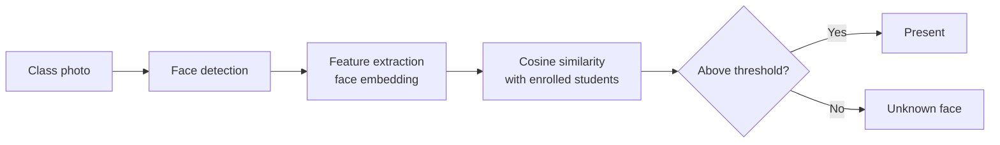

Existing face-based attendance projects often stop at a desktop script. They seldom include course management, teacher review of uncertain results, roles and reports. This project combines recognition with a complete web workflow.

## 6. Proposed System

### 6.1 System Overview
The teacher uses a web browser to open the application, which runs on the department network. The Flask server handles login, roles and the attendance workflow, calls the face service for recognition, and stores data in an SQLite database and a photo folder.

<p align="center">
  <br>
  <em>Figure 1: System architecture of the Smart Attendance System</em>
</p>

### 6.2 Main Features
- Student, course and teacher management with edit and delete (delete for the administrator only)
- Several face photographs per student, stored as embeddings
- Taking attendance from a camera frame or an uploaded class photograph
- Review of unknown faces and manual correction of marks
- Finalizing a class, and re-opening it if a correction is needed
- Session report, month sheet and CSV export
- Hashed passwords, login protection and a dark mode option

### 6.3 Working Procedure
The teacher selects a course and a date, provides a class photograph, and the system detects the faces and compares them with the students enrolled in that course. Students above the threshold are marked present, the remaining faces go to an unknown list, and the teacher reviews the result. When the class is finalized, unmarked students become absent.

<p align="center">
  <br>
  <em>Figure 2: Flowchart of taking attendance</em>
</p>

### 6.4 Role Permissions

| Action | Teacher | Administrator |
|---|:---:|:---:|
| Log in, change own password | ✔ | ✔ |
| Add / edit students and courses | ✔ | ✔ |
| Take attendance, review, finalize | ✔ | ✔ |
| View reports and month sheet | ✔ | ✔ |
| Delete students and courses | ✘ | ✔ |
| Add / edit / delete teachers | ✘ | ✔ |

## 7. System Design and Diagrams

### 7.1 Use Case Diagram
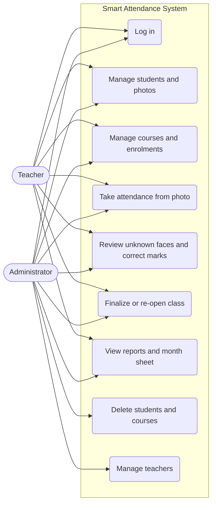

### 7.2 Data Flow Diagram (Level 0, Context Diagram)
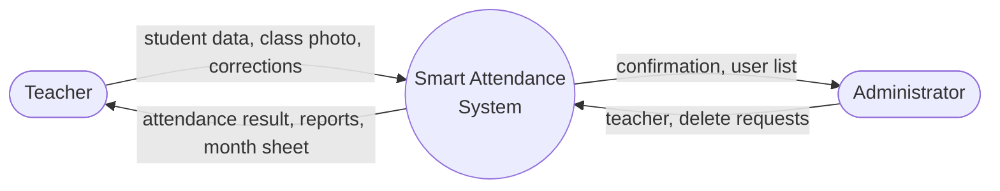

### 7.3 Data Flow Diagram (Level 1)
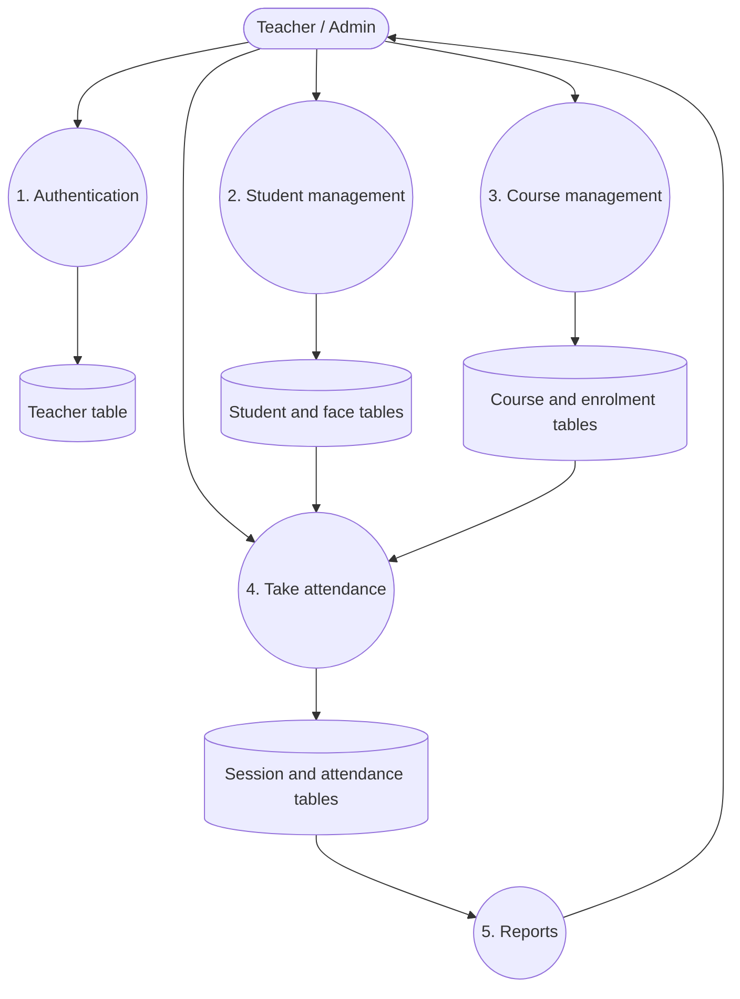

### 7.4 Sequence Diagram: Taking Attendance
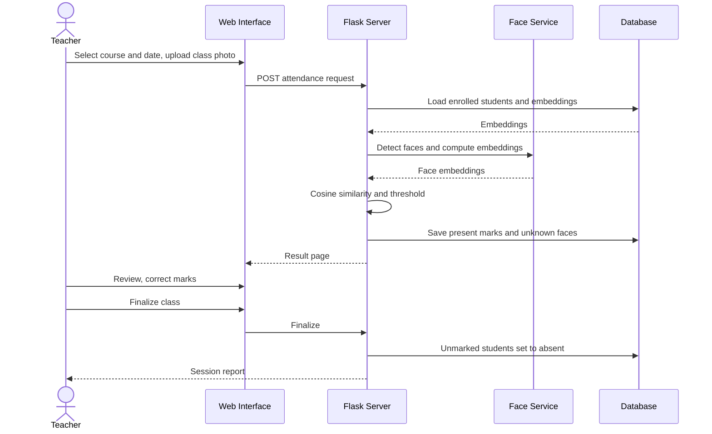

### 7.5 State Diagram: Class Session
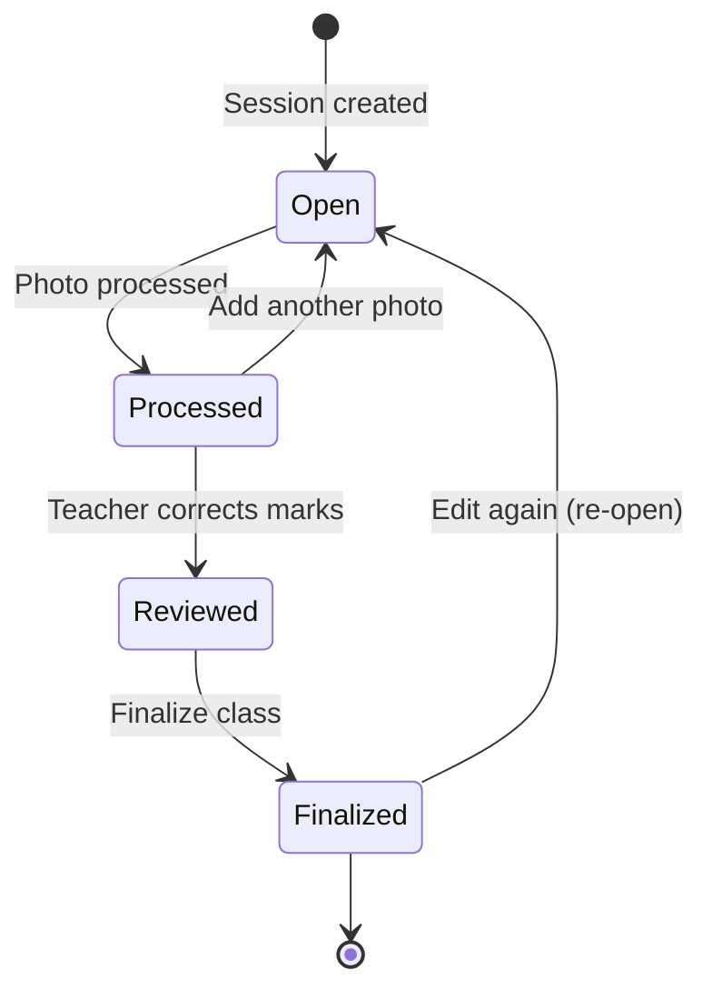

### 7.6 Class Diagram
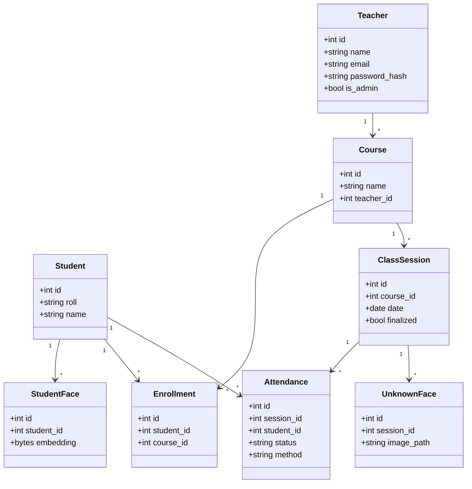

### 7.7 Entity-Relationship Diagram
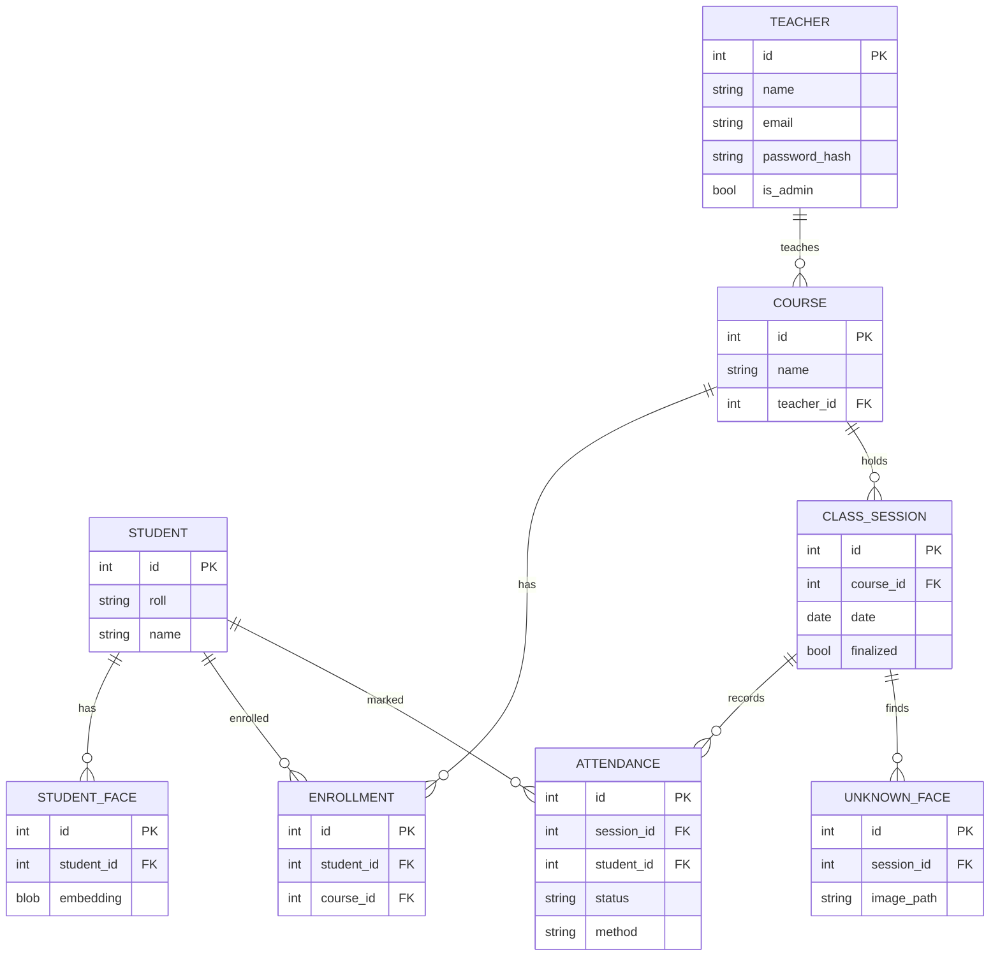

<p align="center">
  <br>
  <em>Figure 3: Entity-relationship diagram (image version)</em>
</p>

### 7.8 Deployment Diagram
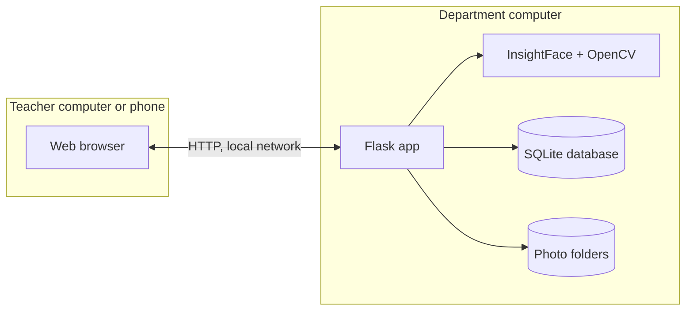

## 8. Methodology
The project follows the **waterfall model**. Each phase is completed and reviewed before the next begins, which suits this project because its requirements are clear from the start.

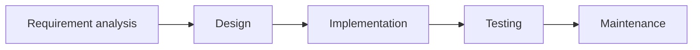

### 8.1 Tools and Technologies

| Part | Technology |
|---|---|
| Frontend | HTML, CSS, JavaScript, Jinja2 |
| Backend | Python, Flask, Flask-Login, Flask-SQLAlchemy |
| Face recognition | InsightFace, OpenCV, NumPy |
| Database | SQLite |
| Security | Hashed passwords (Werkzeug), role check |
| Hardware | Ordinary computer, CPU only, camera or phone |

### 8.2 Recognition Rule

| Situation | Result |
|---|---|
| Similarity above the threshold | Marked **Present** (automatic) |
| No enrolled student matches | Added to the **Unknown** list for the teacher |
| Student not marked when class is finalized | Marked **Absent** (automatic) |

## 9. Requirements

### 9.1 Functional Requirements
- The system shall allow login for teachers and the administrator.
- The system shall add, list, edit and delete students with a unique roll number.
- The system shall store face photographs for each student.
- The system shall create courses and enrol students.
- The system shall mark attendance from a class photograph and allow manual correction.
- The system shall finalize classes and produce reports and month sheets.
- The system shall let only the administrator delete students and courses.

### 9.2 Non-Functional Requirements
- **Usability:** a simple interface that a teacher can use without training.
- **Security:** passwords stored as hashes, and delete rights only for the administrator.
- **Performance:** a class photograph is processed in a few seconds on a normal computer.
- **Portability:** runs on any computer with Python, without a graphics card.
- **Reliability:** a finalized class keeps its record, and can be re-opened only on purpose.

## 10. Security Design
- Passwords are stored as hashes (Werkzeug), never as plain text.
- Pages are protected by login; a visitor who is not logged in is sent to the login page.
- Dangerous actions (delete student, delete course, manage teachers) are checked on the server by an administrator-only rule, not only hidden in the interface.
- Student photographs and the database are kept outside the public repository.

## 11. Testing
The system is checked by unit, integration, system and user acceptance testing. Sample test cases:

| ID | Test case | Expected result | Status |
|---|---|---|:---:|
| TC-01 | Log in with correct password | Teacher dashboard opens | Pass |
| TC-02 | Log in with wrong password | Error message, no login | Pass |
| TC-03 | Open /students without logging in | Redirected to the login page | Pass |
| TC-04 | Teacher tries to delete a student | Refused (administrator only) | Pass |
| TC-05 | Add a student with a duplicate roll number | Rejected | Pass |
| TC-06 | Upload a class photo with enrolled students | Recognised students marked present | Pass |
| TC-07 | Upload a photo with an unknown face | Face goes to the unknown list | Pass |
| TC-08 | Finalize a class | Unmarked students become absent | Pass |
| TC-09 | Re-open a finalized class | Marks can be edited again | Pass |
| TC-10 | Open the month sheet | Totals and percentages are shown | Pass |

## 12. Work Plan

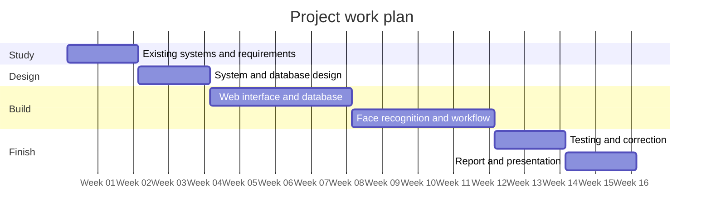

| Phase | Activity | Duration |
|:---:|---|:---:|
| 1 | Study of existing systems and requirement analysis | 2 weeks |
| 2 | System and database design | 2 weeks |
| 3 | Implementation of web interface and database | 4 weeks |
| 4 | Face recognition module and attendance workflow | 4 weeks |
| 5 | Testing and correction | 2 weeks |
| 6 | Report writing and presentation | 2 weeks |

## 13. Expected Outcome
At the end of the project we expect a working web application that reduces the time spent on roll calls, makes proxy attendance difficult, keeps accurate attendance records and produces reports automatically. The system will also give the department a base for future work such as liveness detection, mobile applications and automatic notifications.

## 14. Future Work
- [ ] Liveness detection to stop photo spoofing
- [ ] Student join date in a course
- [ ] Bulk import of students from a file
- [ ] Low-attendance warnings and notifications
- [ ] Mobile application
- [ ] Support for a larger database (PostgreSQL / MySQL)

## 15. Conclusion
The Smart Attendance System replaces slow and error-prone manual attendance with a simple, low-cost, face-recognition-based web application. It keeps the teacher in control through a review step and protects records through separate roles.

## 16. How to Run
```bash
git clone https://github.com/YOUR_USERNAME/smart-attendance-system.git
cd smart-attendance-system
python -m venv venv
venv\Scripts\activate        # Windows  (Linux/Mac: source venv/bin/activate)
pip install -r requirements.txt
python app.py
```
Open `http://127.0.0.1:5000` in a browser.

**Create an administrator:** run `python make_admin.py`, then log out and log in again.

> Student photos and the database (`instance/`, `enroll_photos/`) are not included in this repository for privacy.

## 17. Project Structure
```text
smart-attendance-system/
├── app.py                 # application entry point
├── make_admin.py          # makes a teacher an administrator
├── auth_utils.py          # admin_required and helpers
├── requirements.txt
├── routes/                # blueprints: auth, students, courses, teachers, attendance
├── templates/             # Jinja2 pages
├── static/                # CSS, JavaScript
├── docs/                  # diagrams used in this README
├── instance/              # SQLite database (not in the repository)
└── enroll_photos/         # student photos (not in the repository)
```
Folder names above are a guide; change them to match your project.

## References
1. F. Schroff, D. Kalenichenko and J. Philbin, "FaceNet: A unified embedding for face recognition and clustering," in *Proc. IEEE Conf. Computer Vision and Pattern Recognition (CVPR)*, 2015, pp. 815–823.
2. J. Deng, J. Guo, N. Xue and S. Zafeiriou, "ArcFace: Additive angular margin loss for deep face recognition," in *Proc. IEEE/CVF Conf. Computer Vision and Pattern Recognition (CVPR)*, 2019, pp. 4690–4699.
3. Pallets Projects, "Flask documentation." https://flask.palletsprojects.com
4. InsightFace project, "InsightFace: 2D and 3D face analysis project." https://github.com/deepinsight/insightface
